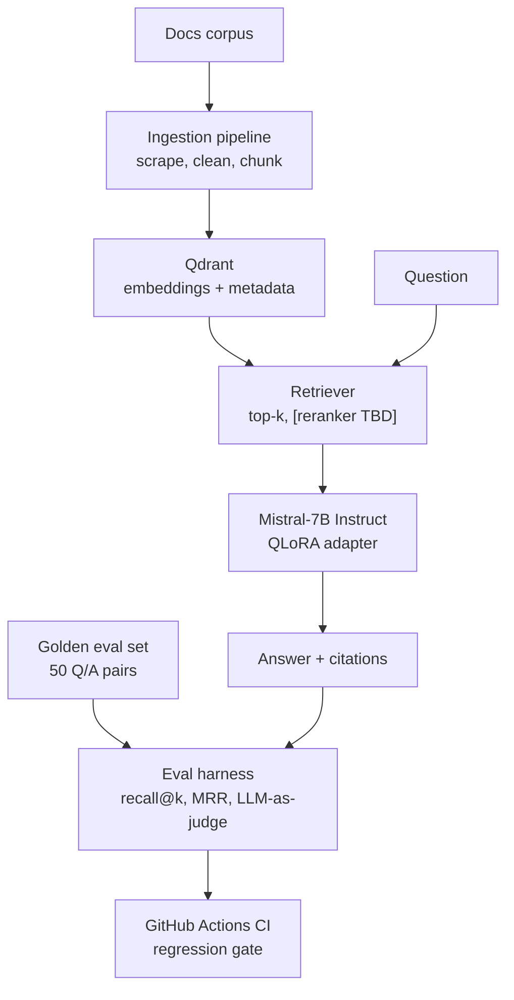

# terraform-domain-assistant

> **Does fine-tuning actually beat RAG?** A measured answer: QLoRA fine-tuned Mistral-7B + retrieval over Terraform docs, gated by a CI eval harness.

[](https://github.com/Alaiitoc/terraform-domain-assistant/actions/workflows/ci.yml)  [Adapter on Hugging Face](TBD-hf-url)

## Why

Most RAG demos stop at "it answers". I wanted the three things that make an LLM system trustworthy:

1. **A measured baseline** — retrieval metrics before any training
2. **A fine-tune that's actually justified** — QLoRA on an open-weight model, tested against that baseline
3. **Regression gates** — an eval harness that runs in CI, so no change ships blind

Most of my other projects live on the data and tooling side of the stack; this one is my way of getting hands-on with the model side.

## Architecture



## Results

| Metric | Baseline (RAG only, [TBD] model) | Fine-tuned (QLoRA) |
|---|---|---|
| Retrieval recall@5 | TBD | unchanged (same retriever) |
| Retrieval MRR | TBD | unchanged |
| Faithfulness (judge) | TBD | TBD |
| Answer relevance (judge) | TBD | TBD |

**Takeaway**: TBD — one honest paragraph. *"The adapter improved X by Y points on Z; it degraded W, which I attribute to [reasoning]. Training loss alone was not enough to decide — the eval harness was."*

## Quickstart

```bash
git clone https://github.com/Alaiitoc/terraform-domain-assistant
cd terraform-domain-assistant
docker compose up -d          # Qdrant + API
make ingest                   # build the vector index
make ask QUESTION="What is the difference between count and for_each in Terraform?"   # ask something
make eval                      # run the eval harness, print scorecard
```

Requires: Python 3.11+, Docker, ~8 GB RAM for local inference via Ollama (confirm on first run).

## Fine-tuning

| | |
|---|---|
| Base model | `mistralai/Mistral-7B-Instruct-v0.3` |
| Method | QLoRA (4-bit NF4 base + LoRA rank 16, alpha 16) |
| Frameworks | Unsloth + Hugging Face TRL `SFTTrainer`, PEFT, bitsandbytes |
| Training data | TBD synthetic Q/A pairs generated from the corpus, deduplicated and filtered |
| Hardware & cost | TBD (e.g., free Colab T4 / rented GPU, ~$X, ~Y h) |
| Training time | TBD |
| LoRA target modules | q_proj, k_proj, v_proj, o_proj, gate_proj, up_proj, down_proj |
| LR / epochs / batch | TBD |
| Adapter size | TBD MB — [published on Hugging Face](TBD-hf-url) |

Reproduce: `make train` then `make eval` — training script at `src/finetune/train.py`, config in `configs/`.

## Evaluation methodology

- **Golden set**: 50 question/answer pairs written from the corpus before any training (held-out; no train/eval leakage)
- **Retrieval**: recall@k, MRR over chunk ids
- **Generation**: LLM-as-judge scoring faithfulness and relevance (judge model: TBD, prompt versioned in `configs/`)
- **CI**: `pytest` + eval regression on push; a PR that drops a metric below the gate fails

## Repo layout

```
src/
├── ingestion/    # scrape → clean → chunk → embed
├── rag/          # retriever + prompt + generator
├── finetune/     # dataset builder + QLoRA training
├── eval/         # golden set, metrics, judge, scorecard
└── api/          # FastAPI endpoint (/ask → answer + sources)
```

## Status

- [ ] RAG pipeline (retrieval + citations)
- [ ] Eval harness with baseline scores
- [ ] QLoRA fine-tune + comparison
- [ ] Adapter published on Hugging Face
- [ ] FastAPI + Docker serving
- [ ] Write-up: what I learned

## What I learned

TBD — keep this honest and technical: chunking decisions that mattered, where the fine-tune helped vs didn't, eval-set pitfalls (e.g., questions the corpus couldn't answer), and what you'd do differently.

## Links

- LoRA adapter: [Hugging Face](TBD-hf-url)
- Eval scorecard artifact: [CI run](TBD-url)
- My notes on the process: [TBD blog post / discussion]
