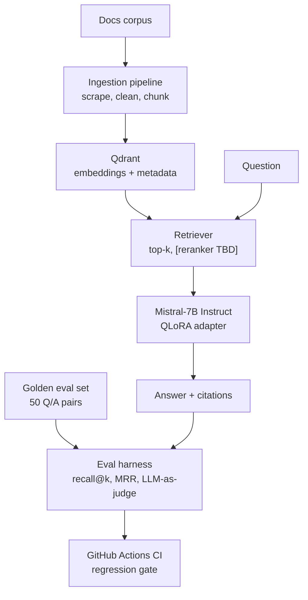

# llm-domain-assistant

> **Does fine-tuning actually beat RAG?** A measured answer: QLoRA fine-tuned Mistral-7B + retrieval over Terraform docs, gated by a CI eval harness.

[](https://github.com/Alaiitoc/llm-domain-assistant/actions/workflows/ci.yml)  [Adapter on Hugging Face](TBD-hf-url)

## Why

Most RAG demos stop at "it answers". I wanted the three things that make an LLM system trustworthy:

1. **A measured baseline** — retrieval metrics before any training
2. **A fine-tune that's actually justified** — QLoRA on an open-weight model, tested against that baseline
3. **Regression gates** — an eval harness that runs in CI, so no change ships blind

Most of my other projects live on the data and tooling side of the stack; this one is my way of getting hands-on with the model side.

## Architecture



## Phase 1 — RAG pipeline (measured)

Shipped and verified end-to-end: `make ask` retrieves over the vector index and answers with `[n]` citations pointing at the live docs.

| Measurement | Value |
|---|---|
| Corpus | 384 Terraform docs pages (v1.16.x MDX from `hashicorp/web-unified-docs` — the source that renders developer.hashicorp.com) |
| Chunks | 2,715 — avg 819 chars (target 800, overlap 100), fenced code blocks atomic |
| Index | Qdrant `terraform_docs` — 2,715 points, 1024-dim `mistral-embed`, cosine |
| Retrieval latency | ~1s (query embedding API + Qdrant search) |
| Generation latency | 52-64s per answer (Mistral-7B q4_K_M, CPU-only, 512-token cap) |
| In-domain query score band (top-5) | 0.832 - 0.844 |
| Out-of-domain query score band (top-5) | 0.744 - 0.770 |

**Measured on**: Intel i5-7300HQ (4 cores @ 2.50-3.50 GHz), 16 GB RAM, 2017-era laptop. GPU: GTX 1050 Ti (4 GB, Pascal) — present but unused; the 4 GB VRAM can't hold the ~5 GB q4 model regardless, so treat all generation latencies above as **CPU floor values**. The same answers on any modern GPU are seconds; the deterministic retrieval metrics above are hardware-independent (one API call + one Qdrant query).

Observed behavior worth keeping:

- **Grounded refusal works.** Asked about something absent from the corpus ("What is the Spark API?"), the assistant states the context doesn't contain the answer instead of guessing — at similarity scores ~0.06 below every in-domain band observed so far.
- **That score gap is a future cheap guard** (query below threshold → skip generation, answer "not in the docs" instantly). The threshold gets set from golden-set score distributions in Phase 2 — measured, not guessed.

CPU-only inference is a deliberate constraint, not an accident: this laptop has no usable GPU, generation rents one, the deterministic retrieval metrics run anywhere. Dependencies follow that split (see Evaluation methodology).

## Results

| Metric | Baseline (RAG only, [TBD] model) | Fine-tuned (QLoRA) |
|---|---|---|
| Retrieval recall@5 | TBD | unchanged (same retriever) |
| Retrieval MRR | TBD | unchanged |
| Faithfulness (judge) | TBD | TBD |
| Answer relevance (judge) | TBD | TBD |

**Takeaway**: TBD — one honest paragraph. *"The adapter improved X by Y points on Z; it degraded W, which I attribute to [reasoning]. Training loss alone was not enough to decide — the eval harness was."*

## Quickstart

```bash
git clone https://github.com/Alaiitoc/llm-domain-assistant
cd llm-domain-assistant
docker compose up -d          # Qdrant + API
make ingest                   # build the vector index
make ask QUESTION="What is the difference between count and for_each in Terraform?"   # ask something
make eval                      # run the eval harness, print scorecard
```

Requires: Python 3.12+, Docker (Qdrant), a Mistral API key for embeddings (`MISTRAL_API_KEY`, embeddings cost ~$0.02 for the full corpus), and [Ollama](https://ollama.com) with `mistral:7b-instruct-v0.3-q4_K_M` for local generation (CPU works: ~1 min/answer).

## Fine-tuning

| | |
|---|---|
| Base model | `mistralai/Mistral-7B-Instruct-v0.3` |
| Method | QLoRA (4-bit NF4 base + LoRA rank 16, alpha 16) |
| Frameworks | Unsloth + Hugging Face TRL `SFTTrainer`, PEFT, bitsandbytes |
| Training data | TBD synthetic Q/A pairs generated from the corpus, deduplicated and filtered |
| Hardware & cost | TBD (e.g., free Colab T4 / rented GPU, ~$X, ~Y h) |
| Training time | TBD |
| LoRA target modules | q_proj, k_proj, v_proj, o_proj, gate_proj, up_proj, down_proj |
| LR / epochs / batch | TBD |
| Adapter size | TBD MB — [published on Hugging Face](TBD-hf-url) |

Reproduce: `make train` then `make eval` — training script at `src/finetune/train.py`, config in `configs/`.

## Evaluation methodology

- **Golden set**: 50 question/answer pairs written from the corpus before any training (held-out; no train/eval leakage)
- **Retrieval**: recall@k, MRR, labeled at **source-page level** so relevance labels survive re-chunking experiments
- **Generation**: LLM-as-judge scoring faithfulness and relevance (judge model: TBD, prompt versioned in `configs/`)
- **CI**: `pytest` + eval regression on push; a PR that drops a metric below the gate fails

## Repo layout

```
src/
├── clients.py       # connection factories: Mistral, Qdrant (secrets/env only here)
├── qdrant_store.py  # point payload schema + collection lifecycle (round-trip tested)
├── ingestion/       # clean → chunk → embed → upsert
├── rag/             # retriever + prompt + generator
├── finetune/        # dataset builder + QLoRA training
├── eval/            # golden set, metrics, judge, scorecard
└── api/             # FastAPI endpoint (/ask → answer + sources)
```

## Status

- [x] RAG pipeline (retrieval + citations)
- [ ] Eval harness with baseline scores
- [ ] QLoRA fine-tune + comparison
- [ ] Adapter published on Hugging Face
- [ ] FastAPI + Docker serving
- [ ] Write-up: what I learned

## What I learned

- **Guessing loses to measuring.** Generation timeout, answer-length cap, and the future out-of-domain guard (in-corpus queries score 0.83+, out-of-corpus 0.74-0.77) all came from probe runs, not defaults — one timed request and two queries replaced a page of estimation.
- **Real data finds what tests can't.** Two silent chunking bugs (an MDX component variant my regex didn't allow; overlap prepending mid-code text because blank lines inside code fences defeat naive `\n\n` splitting) survived 100+ unit tests and were both caught by eyeballing one real doc file. Corpus first, then code.

*(Grows per phase: chunking decisions that mattered, where the fine-tune helped vs didn't, eval-set pitfalls, what I'd do differently.)*

## Links

- LoRA adapter: [Hugging Face](TBD-hf-url)
- Eval scorecard artifact: [CI run](TBD-url)
- My notes on the process: [TBD blog post / discussion]
